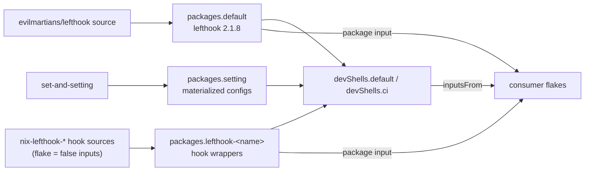
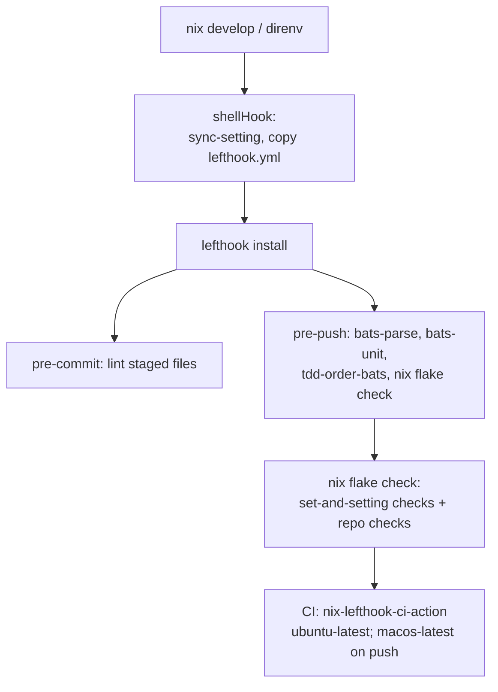

# nix-lefthook

[](https://github.com/pr0d1r2/nix-lefthook/actions/workflows/ci.yml) [](https://nixos.org)

> This code is LLM-generated and validated through an automated integration process using [lefthook](https://github.com/evilmartians/lefthook) git hooks, [bats](https://github.com/bats-core/bats-core) unit tests, and GitHub Actions CI.

Pinned [lefthook](https://github.com/evilmartians/lefthook) binary packaged as a Nix flake. Single source of truth for lefthook version across all repos.

**Current version:** 2.1.8

## Architecture



Consumers either add the packages to their own devShell or inherit
`devShells.ci` through `inputsFrom`. Inheriting the shell also inherits
its hook, which writes this repository's generated `lefthook.yml`,
`.markdownlint.yml` and `.yamllint.yml` into the consumer's checkout.

## Development architecture



## Why

nixpkgs ships lefthook 1.13.6 on nixos-25.11. This flake builds 2.1.8 from source using `buildGo126Module`, independent of nixpkgs packaging. All repos consume this flake input to stay on the same version.

## Usage

Add as a flake input:

```nix
inputs.nix-lefthook = {
  url = "github:pr0d1r2/nix-lefthook";
  inputs.nixpkgs.follows = "nixpkgs";
};
```

Add to your devShell:

```nix
nix-lefthook.packages.${pkgs.stdenv.hostPlatform.system}.default
```

The per-hook repositories are source repositories for this flake, not the
consumer-facing package API. After the hooks moved into this repository, use
the wrapper packages here:

```nix
nix-lefthook.packages.${pkgs.stdenv.hostPlatform.system}.lefthook-bats-parse
nix-lefthook.packages.${pkgs.stdenv.hostPlatform.system}.lefthook-editorconfig-checker
nix-lefthook.packages.${pkgs.stdenv.hostPlatform.system}.lefthook-git-no-local-paths
nix-lefthook.packages.${pkgs.stdenv.hostPlatform.system}.lefthook-justfile-alphabetical
nix-lefthook.packages.${pkgs.stdenv.hostPlatform.system}.lefthook-markdownlint
nix-lefthook.packages.${pkgs.stdenv.hostPlatform.system}.lefthook-yamllint
```

Do not use `inputs.nix-lefthook-<name>.packages.${system}.default`: those
per-hook flakes now expose only their setting and retain no binary package.
Likewise, remove obsolete `inputs.nix-lefthook-bats-failures-only` follows
from `nix-lefthook-bats-changed`; the failures-only wrapper is provided by
this flake as `lefthook-bats-failures-only`.

## Recommended lefthook.yml config

Configure lefthook to only show output on failure:

```yaml
output:
  - failure
```

This keeps git hooks silent on success. Developers only see output when something breaks.

## Updating lefthook version

Edit `flake.nix` — update `version`, `hash`, and `vendorHash`:

```bash
# Get new source hash
nix-prefetch-github evilmartians lefthook --rev v2.2.0

# Build and let Nix report the correct vendorHash
nix build  # will fail with expected hash — copy the correct one
```

## Development

```bash
cd nix-lefthook  # direnv loads the flake
bats tests/unit/
```

## License

MIT
